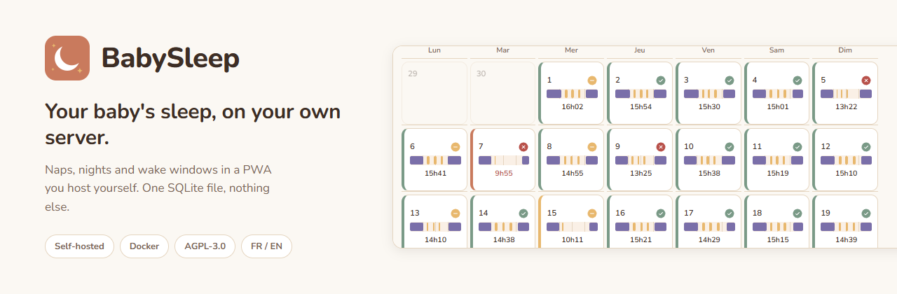
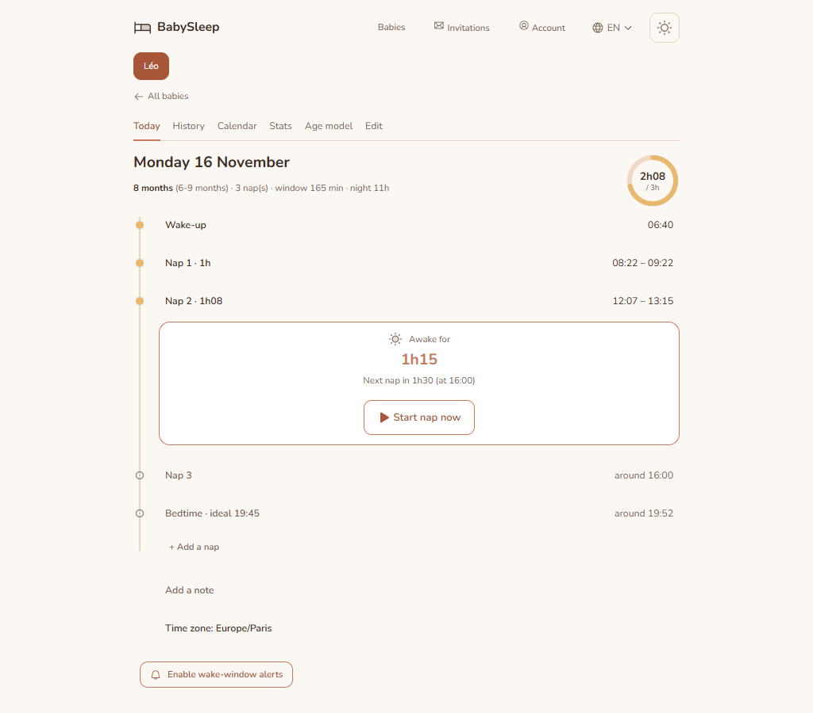
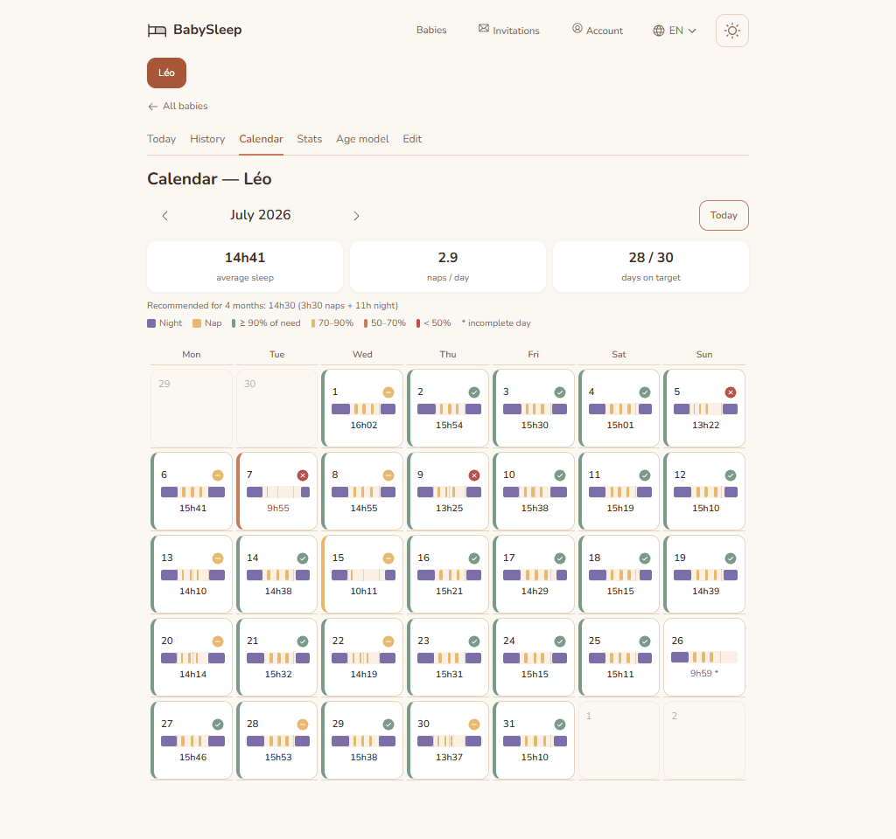
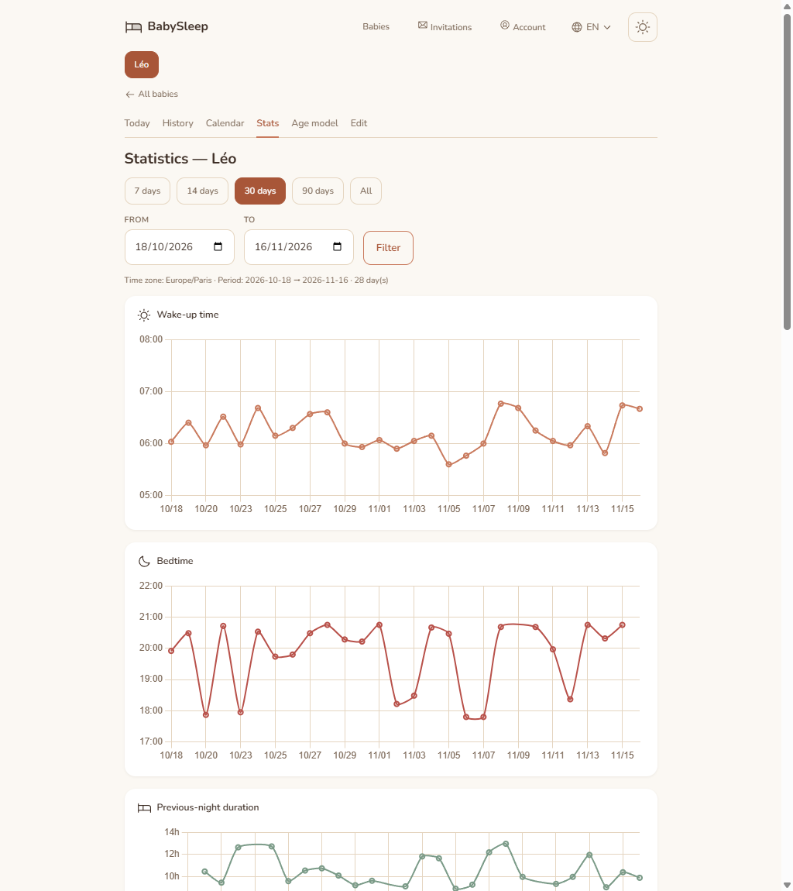
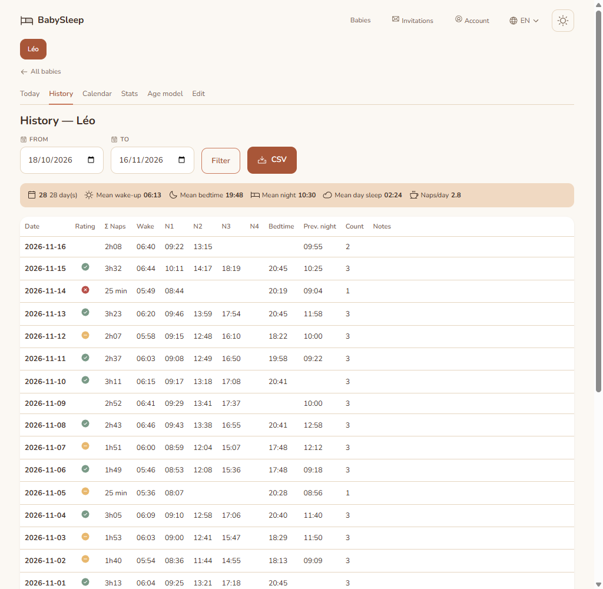
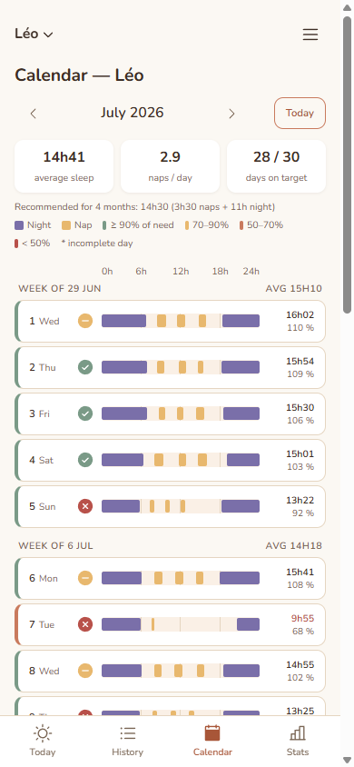
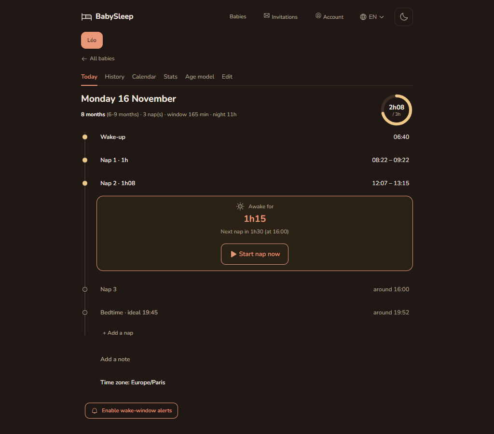

# BabySleep

A self-hosted PWA for tracking your baby's sleep, naps, and night-time patterns.
Built for parents who want to keep their family data on their own server.

[](LICENSE)
[](https://github.com/Gavark/babysleep/releases)
[](https://github.com/Gavark/babysleep/pkgs/container/babysleep)
[](https://github.com/Gavark/babysleep/actions/workflows/ci.yml)

🇫🇷 [Readme en français](./README.md)



---

## What is this?

BabySleep is a small web app you run on your own machine (Raspberry Pi, NAS,
VPS, laptop: whatever runs Docker). It helps you:

- Log your baby's wake time, naps, and bedtime
- See an age-appropriate suggestion for the next nap and tonight's bedtime
- Track progress over weeks with a calendar and a stats page
- Rate each night manually (good / so-so / rough) for at-a-glance review later
- Share access with a partner via private invitations

No cloud, no analytics, no account on someone else's server. Your data lives in
a single SQLite file on a Docker volume you control.

---

## Features

- **Today view** — the day as a timeline: wake-up, naps, bedtime, with the
  suggested times for what comes next and a live "wake-window" timer.
  Autosave, built for two phones on the same day.
- **Calendar** — month grid (or a list by week on mobile) with a 24h timeline
  per day, the share of the age-recommended sleep reached, a month summary,
  and a manual rating per night (✓ / − / ✗).
- **Mobile navigation** — a tab bar at the bottom of the screen on phones.
- **History** — filterable table with CSV export.
- **Stats** — charts of averages over the period (wake time, bedtime, nap
  durations).
- **Multi-baby** — track several babies under the same account.
- **Multi-user** — admin generates time-limited invitation links; password-based
  auth with argon2id hashing.
- **PWA** — installable from the browser; iOS standalone-capable with the
  proper apple-touch-icon and metas.
- **Web Push notifications** — opt-in per device, fires when the wake window
  is exceeded; works on Chrome/Firefox/Edge desktop and mobile, plus iOS
  Safari 16.4+ (PWA installed to the home screen).
- **Timezone-aware** — per-user, per-baby, and per-entry overrides.

Bilingual UI (FR / EN), auto-detected from the browser's Accept-Language
header at first login, switchable from the header (🌐, inside the ☰ menu on
phones) or /account.

---

## Screenshots

<table>
  <tr>
    <td width="50%"></td>
    <td width="50%"></td>
  </tr>
  <tr>
    <td align="center"><sub>Today, the day as a timeline</sub></td>
    <td align="center"><sub>Month calendar, 24 h timeline and month summary</sub></td>
  </tr>
  <tr>
    <td></td>
    <td></td>
  </tr>
  <tr>
    <td align="center"><sub>Stats over a date range</sub></td>
    <td align="center"><sub>Filterable history, CSV export</sub></td>
  </tr>
  <tr>
    <td></td>
    <td></td>
  </tr>
  <tr>
    <td align="center"><sub>Calendar on mobile, by week</sub></td>
    <td align="center"><sub>Dark mode</sub></td>
  </tr>
</table>

---

## Quick start (Docker)

You need Docker and Docker Compose v2.

```bash
git clone https://github.com/Gavark/babysleep.git
cd babysleep
cp .env.example .env
# .env.example works as-is for a first test; re-read it to customise TZ,
# ORIGIN, or to opt into the scripted-admin setup.
docker compose -f docker-compose.quickstart.yml up -d
```

Open <http://localhost:3000> in your browser. A setup wizard creates your
admin account; after that, log in and start tracking.

This compose file puts a small Caddy in front of the app, over plain HTTP:
without a proxy declaring the protocol, the app rejects every form (403). It is
meant for trying BabySleep on your machine, not for exposing it to the internet.

### Behind a reverse proxy with HTTPS

If you want HTTPS via Let's Encrypt and a domain, the project ships a full
stack with Caddy + a nightly SQLite backup sidecar:

```bash
cp Caddyfile.example Caddyfile
# Edit Caddyfile and set your domain (DNS A/AAAA records must point at this host)
docker compose -f docker-compose.full.yml up -d
```

If you prefer Nginx Proxy Manager, Traefik, or your own reverse proxy, switch
to the minimal `docker-compose.yml` and point your proxy at port 3000. That port
isn't meant to be opened directly in a browser.

---

## Configuration

All configuration is environment variables. See [`.env.example`](./.env.example)
for the full annotated list. Highlights:

| Variable | Required | Description |
|---|---|---|
| `ADMIN_EMAIL`, `ADMIN_PASSWORD` | no | Skip the setup wizard for scripted deployments. |
| `DISABLE_SIGNUP` | no | `true` to block `/signup` entirely. Invitations still work. |
| `ORIGIN` | no | Public URL, only used for the default VAPID subject. The CSRF check relies on the proxy headers (`PROTOCOL_HEADER`, `HOST_HEADER`). |
| `TZ` | no | Container timezone. Default `Europe/Paris`. |
| `VAPID_SUBJECT` | no | Override the VAPID subject (default: `mailto:admin@<host>` derived from `ORIGIN`). |

Sessions are secured by 256-bit random IDs stored in `HttpOnly` + `Secure` +
`SameSite=Lax` cookies and validated against the database on every request, so
there is no "session secret" to manage.

---

## Backup

`docker-compose.full.yml` ships a backup sidecar that copies the SQLite DB
into `./backups/` every night at 03:00 (configurable via `BACKUP_SCHEDULE`).
Retention defaults to 30 daily snapshots (`BACKUP_RETENTION`).

To trigger a backup on demand:

```bash
docker compose -f docker-compose.full.yml exec backup sh /usr/local/bin/run-backup
```

If you use the minimal compose, bring your own backup tooling (restic, borg, …)
pointed at the `babysleep_data` Docker volume.

Snapshots stay on the machine that hosts the app. To keep a copy elsewhere,
[docs/BACKUP.md](./docs/BACKUP.md#off-site) has an rclone example for Linux
and, for a Windows host, `scripts/sync-backups-offsite.ps1`: a scheduled task
that copies the recent snapshots into a synced folder every night (Google
Drive, OneDrive, a network share) and keeps only the last 7 days there.

---

## Web Push notifications

The app can send you a push notification when a baby's wake window is exceeded.
It's opt-in per device: enable it from `/account/notifications` or directly
from the Today page.

- VAPID keys are generated automatically on first server start and stored in
  the database (no environment variable needed to bootstrap).
- Push notifications require HTTPS. If you use Caddy (or any reverse proxy
  with HTTPS), there's nothing extra to configure.
- You can review the list of subscribed devices and revoke them one by one
  from `/account/notifications`.
- On iPhone, you must first install the app to the home screen (Share →
  "Add to Home Screen") then reopen the installed app to enable alerts.

If you see `VAPID_SUBJECT` mentioned in `.env.example`, it's an optional
override for push services (Mozilla autopush in particular) that are strict
about the `mailto:` in the VAPID header.

---

## Upgrade

```bash
git pull
docker compose -f docker-compose.full.yml pull app
docker compose -f docker-compose.full.yml up -d app
```

The app applies pending Drizzle migrations at startup. Migrations to date are
additive only (no drops, no destructive changes), so your data is kept from one
version to the next.

---

## Reset your password

```bash
docker compose exec app npm run reset-password -- your@email
```

You'll be prompted for a new password. **No data is lost**: only the password
hash is replaced in the database. Your babies, sleep entries and invitations
are kept.

However, **all your active sessions are signed out** (including the one you
are using when you run the reset). This is deliberate: it stops a stolen
session from staying valid with the old password. Sign in again with the new
one.

## Active sessions

The `/account` page lists your open sessions (browser, last used, device).
There are three ways to end them:

- **End one session**: the "Revoke" button next to each row on `/account`.
  The session you are using right now has no such button: for that one, use
  "Sign out" at the bottom of `/account`.
- **End all the others**: the "Change my password" section of `/account`
  signs out every other session automatically once the change succeeds (yours
  stays signed in).
- **End them all at once**: the `reset-password` CLI above, or straight SQL:

  ```bash
  docker compose exec app sqlite3 /data/babysleep.sqlite \
    "DELETE FROM sessions WHERE user_id = (SELECT id FROM users WHERE email='your@email');"
  ```

---

## Development

```bash
npm install
cp .env.example .env
mkdir -p data
npm run db:migrate
npm run dev
```

Run the test suite:

```bash
npm test
```

Type-check:

```bash
npm run check
```

Stack: SvelteKit 3 + Svelte 5 (runes) + TypeScript strict, Drizzle ORM over
better-sqlite3, argon2id via `@node-rs/argon2`, Chart.js for stats,
phosphor-svelte for icons, Nunito Variable (self-hosted) for typography.

Internal imports: `#lib/…` for `src/lib/` and `#paraglide/…` for translated
messages, with the file extension (`#lib/format.ts`). They are Node subpath
imports declared in the `imports` field of `package.json`, not SvelteKit's
deprecated `$lib` aliases.

---

## Status

BabySleep has been at `v1` since November 2026 and follows
[SemVer](https://semver.org): within `v1.x`, no breaking change to the data
model or the configuration (environment variables, compose files). A breaking
change would only come with a `v2`, announced in the release notes with the
steps to follow. Migrations stay additive.

---

## License

[AGPL-3.0-or-later](./LICENSE). If you run a modified copy as a public service,
you must publish your modifications under the same license.

---

## Author

Built by [@Gavark](https://github.com/Gavark). Issues and PRs welcome.
