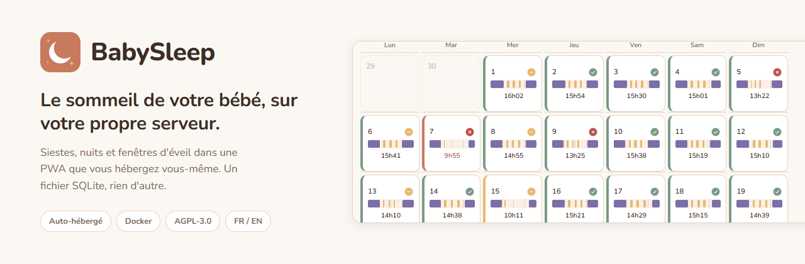
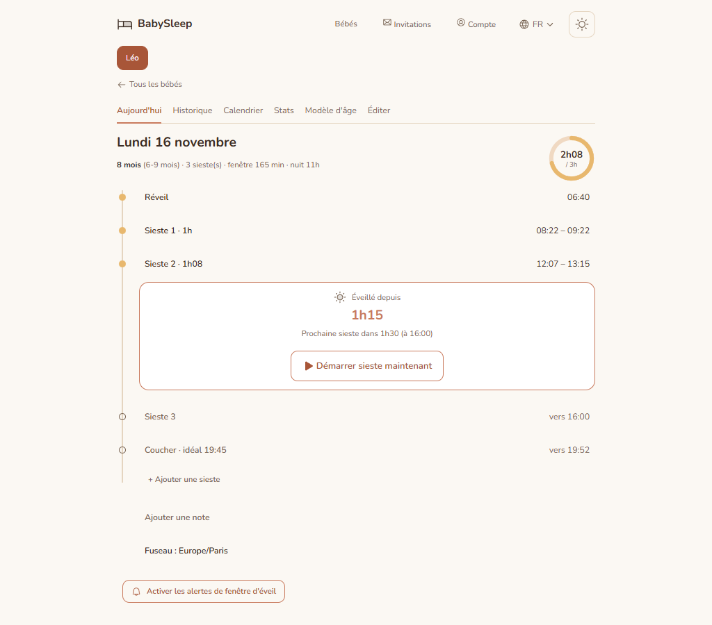
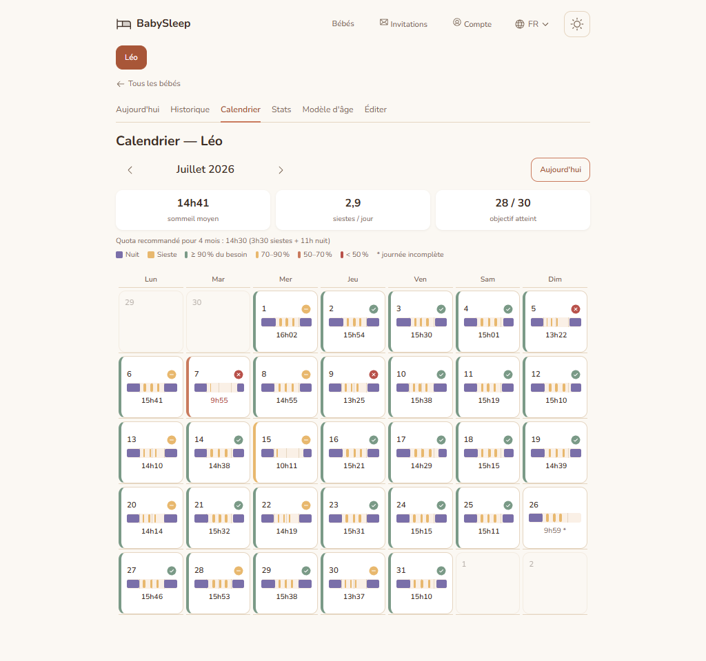
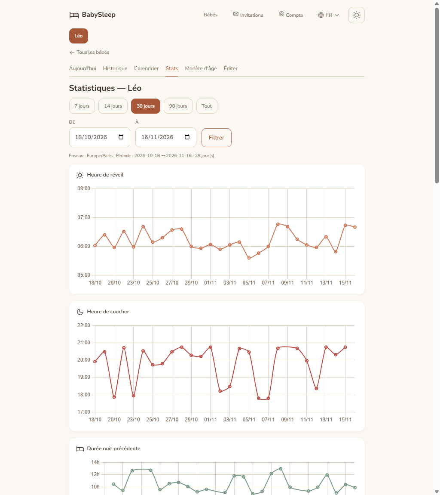
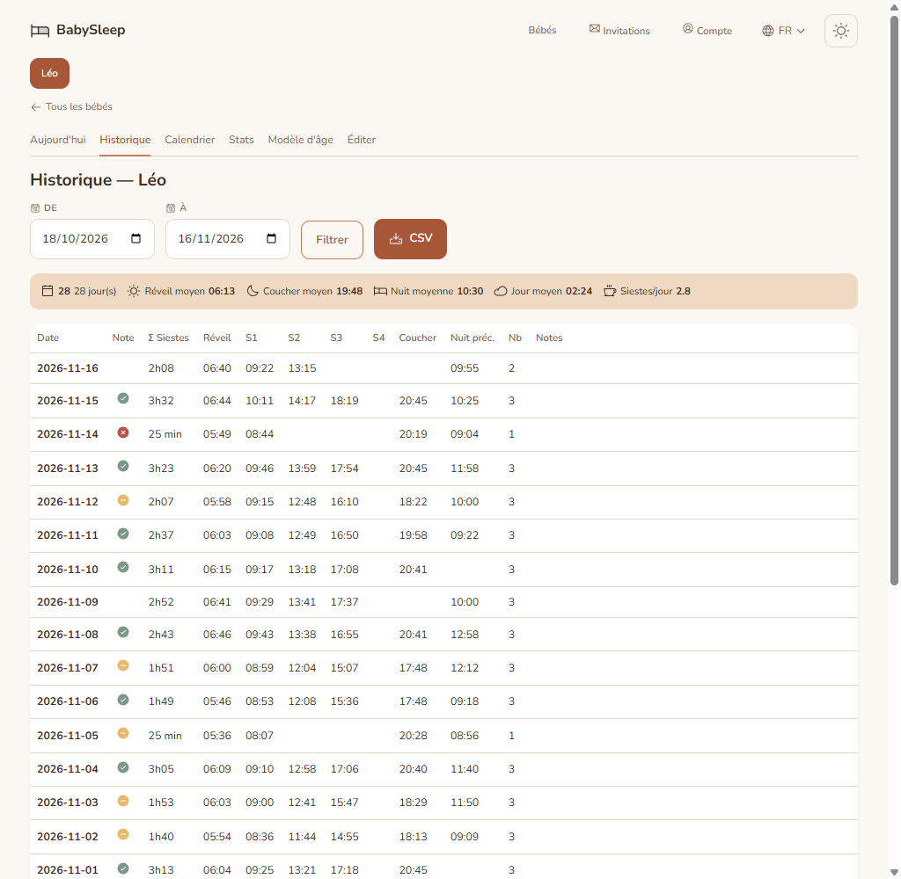
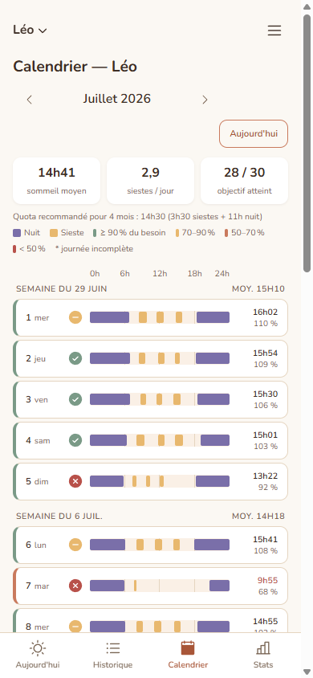
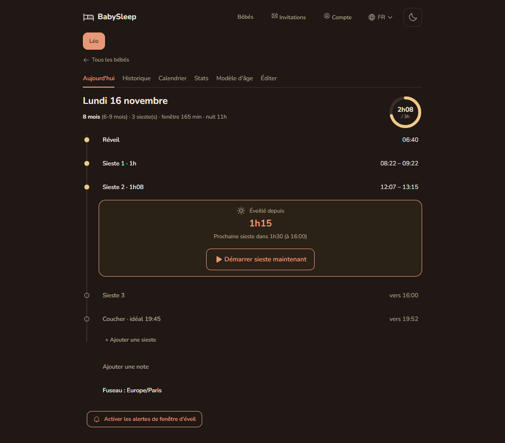

# BabySleep

Une PWA auto-hébergée pour suivre le sommeil, les siestes et les nuits de ton
bébé. Pensée pour les parents qui veulent garder leurs données de famille sur
leur propre serveur.

[](LICENSE)
[](https://github.com/Gavark/babysleep/releases)
[](https://github.com/Gavark/babysleep/pkgs/container/babysleep)
[](https://github.com/Gavark/babysleep/actions/workflows/ci.yml)

🇬🇧 [Read in English](./README.en.md)



---

## C'est quoi ?

BabySleep est une petite app web que tu fais tourner sur ta propre machine
(Raspberry Pi, NAS, VPS, laptop : tout ce qui fait tourner Docker). Elle te
permet de :

- Enregistrer l'heure de réveil, les siestes et le coucher de bébé
- Voir une suggestion par tranche d'âge pour la prochaine sieste et l'heure
  de coucher du soir
- Suivre l'évolution sur plusieurs semaines via un calendrier et une page de
  stats
- Noter chaque nuit manuellement (bonne / moyenne / mauvaise) pour un repère
  visuel rapide
- Partager l'accès avec ton/ta partenaire via des invitations privées

Pas de cloud, pas d'analytics, pas de compte chez un tiers. Tes données vivent
dans un fichier SQLite unique sur un volume Docker que tu contrôles.

---

## Fonctionnalités

- **Vue Aujourd'hui** — la journée en frise : réveil, siestes, coucher, avec
  les heures suggérées pour la suite et un timer live "fenêtre d'éveil".
  Enregistrement automatique, pensé pour deux téléphones sur la même
  journée.
- **Calendrier** — grille mensuelle (ou liste par semaine sur mobile) avec une
  timeline 24h par jour, la part du besoin de sommeil atteinte pour l'âge,
  un résumé du mois et une note manuelle par nuit (✓ / − / ✗).
- **Navigation mobile** — barre d'onglets en bas de l'écran sur téléphone.
- **Historique** — tableau filtrable avec export CSV.
- **Stats** — graphes des moyennes sur la période (heure de réveil, coucher,
  durée des siestes).
- **Multi-bébés** — suivre plusieurs bébés sous le même compte.
- **Multi-utilisateurs** — l'admin génère des liens d'invitation à durée
  limitée ; auth par mot de passe avec hash argon2id.
- **PWA** — installable depuis le navigateur ; mode standalone iOS avec
  apple-touch-icon et metas dédiées.
- **Notifications Web Push** — alerte opt-in par appareil quand la fenêtre
  d'éveil est dépassée ; fonctionne sur Chrome/Firefox/Edge desktop et mobile,
  Safari iOS 16.4+ (PWA installée à l'écran d'accueil).
- **Fuseaux horaires** — overrides par utilisateur, par bébé et par entrée.

UI bilingue FR / EN, auto-détection navigateur (Accept-Language) au premier
login, modifiable depuis le header (🌐, dans le menu ☰ sur téléphone) ou
/account.

---

## Captures d'écran

<table>
  <tr>
    <td width="50%"></td>
    <td width="50%"></td>
  </tr>
  <tr>
    <td align="center"><sub>Aujourd'hui, la journée en frise</sub></td>
    <td align="center"><sub>Calendrier mensuel, timeline 24 h et résumé du mois</sub></td>
  </tr>
  <tr>
    <td></td>
    <td></td>
  </tr>
  <tr>
    <td align="center"><sub>Stats sur une période</sub></td>
    <td align="center"><sub>Historique filtrable, export CSV</sub></td>
  </tr>
  <tr>
    <td></td>
    <td></td>
  </tr>
  <tr>
    <td align="center"><sub>Calendrier sur mobile, par semaine</sub></td>
    <td align="center"><sub>Mode sombre</sub></td>
  </tr>
</table>

---

## Démarrage rapide (Docker)

Tu as besoin de Docker et Docker Compose v2.

```bash
git clone https://github.com/Gavark/babysleep.git
cd babysleep
cp .env.example .env
# .env.example fonctionne tel quel pour un premier test ; relis-le pour
# personnaliser TZ, ORIGIN ou activer le wizard automatisé.
docker compose -f docker-compose.quickstart.yml up -d
```

Ouvre <http://localhost:3000> dans ton navigateur. Tu arrives sur un wizard de
configuration qui crée ton compte admin, puis tu te connectes et tu commences
à enregistrer.

Ce compose met un petit Caddy devant l'app, en HTTP simple : sans proxy qui
déclare le protocole, l'app refuse tous les formulaires (403). Il sert à
essayer BabySleep sur ta machine, pas à l'exposer sur internet.

### Derrière un reverse proxy avec HTTPS

Si tu veux HTTPS via Let's Encrypt et un nom de domaine, le projet ship une
stack complète avec Caddy + un container annexe qui fait un backup SQLite chaque nuit :

```bash
cp Caddyfile.example Caddyfile
# Édite Caddyfile et mets ton domaine (records DNS A/AAAA pointant vers ce host)
docker compose -f docker-compose.full.yml up -d
```

Si tu préfères Nginx Proxy Manager, Traefik ou ton propre reverse proxy, passe
au `docker-compose.yml` minimal et pointe ton proxy vers le port 3000. Ce port
n'est pas fait pour être ouvert directement dans un navigateur.

---

## Configuration

Toute la config passe par des variables d'environnement. Voir
[`.env.example`](./.env.example) pour la liste complète annotée. Les principales :

| Variable | Requis | Description |
|---|---|---|
| `ADMIN_EMAIL`, `ADMIN_PASSWORD` | non | Passe le wizard pour les déploiements scriptés. |
| `DISABLE_SIGNUP` | non | `true` pour bloquer `/signup`. Les invitations marchent quand même. |
| `ORIGIN` | non | URL publique, utilisée seulement pour le sujet VAPID par défaut. Le check CSRF se base sur les en-têtes du proxy (`PROTOCOL_HEADER`, `HOST_HEADER`). |
| `TZ` | non | Fuseau horaire du container. Défaut `Europe/Paris`. |
| `VAPID_SUBJECT` | non | Override du sujet VAPID (défaut : `mailto:admin@<host>` dérivé d'`ORIGIN`). |

Les sessions sont protégées par des IDs aléatoires de 256 bits stockés dans
des cookies `HttpOnly` + `Secure` + `SameSite=Lax` et validés en base à
chaque requête. Il n'y a donc pas de "session secret" à gérer.

---

## Backup

`docker-compose.full.yml` inclut un container dédié qui copie la DB SQLite
dans `./backups/` tous les jours à 03:00 (configurable via `BACKUP_SCHEDULE`).
Rétention par défaut : 30 snapshots quotidiens (`BACKUP_RETENTION`).

Pour déclencher un backup à la demande :

```bash
docker compose -f docker-compose.full.yml exec backup sh /usr/local/bin/run-backup
```

Si tu utilises le compose minimal, apporte ton propre outil de backup
(restic, borg, …) pointé sur le volume Docker `babysleep_data`.

Les snapshots restent sur la machine qui héberge l'app. Pour en garder une
copie ailleurs, [docs/BACKUP.md](./docs/BACKUP.md#off-site) donne un exemple
rclone pour Linux et, pour un hôte Windows,
`scripts/sync-backups-offsite.ps1` : une tâche planifiée qui copie chaque nuit
les snapshots récents dans un dossier synchronisé (Google Drive, OneDrive, un
partage réseau) et n'y garde que les 7 derniers jours.

---

## Notifications Web Push

L'appli sait t'envoyer une notification quand la fenêtre d'éveil d'un bébé
est dépassée. C'est opt-in par appareil : tu actives depuis `/account/notifications`
ou directement depuis la page Aujourd'hui.

- Les clés VAPID sont générées automatiquement au premier démarrage du serveur
  et stockées en base (pas besoin de variable d'environnement pour démarrer).
- Les notifications exigent HTTPS. Si tu utilises Caddy (ou n'importe quel
  reverse proxy avec HTTPS), tu n'as rien à faire de plus.
- Tu peux gérer la liste de tes appareils abonnés et les révoquer un par un
  depuis `/account/notifications`.
- Sur iPhone, il faut d'abord installer l'app à l'écran d'accueil (Partager →
  "Sur l'écran d'accueil") puis ré-ouvrir l'app installée pour activer les alertes.

Si tu vois `VAPID_SUBJECT` mentionné dans `.env.example`, c'est un override
optionnel pour les services push (Mozilla autopush en particulier) qui sont
stricts sur le `mailto:` dans le header VAPID.

---

## Mise à jour

```bash
git pull
docker compose -f docker-compose.full.yml pull app
docker compose -f docker-compose.full.yml up -d app
```

L'app applique les migrations Drizzle en attente au démarrage. Les migrations
à ce jour sont uniquement additives (aucun drop, aucun changement destructif),
donc tes données sont conservées d'une version à l'autre.

---

## Mot de passe oublié

```bash
docker compose exec app npm run reset-password -- ton@email
```

Un prompt te demandera le nouveau mot de passe. **Aucune donnée n'est perdue** :
seul le hash du mot de passe est remplacé en base. Tes bébés, tes saisies de
sommeil et tes invitations sont conservés.

En revanche, **toutes tes sessions actives sont déconnectées** (y compris celle
que tu utilises au moment du reset). C'est volontaire : ça évite qu'une session
volée reste valide avec l'ancien mot de passe. Tu te reconnectes avec le nouveau.

## Sessions actives

La page `/account` liste les sessions ouvertes (navigateur, dernière utilisation,
device). Trois moyens de les couper :

- **Couper une session précise** : bouton "Révoquer" en face de chaque ligne
  sur `/account`. Celle que tu utilises actuellement n'a pas ce bouton : pour
  elle, utilise "Se déconnecter" en bas de `/account`.
- **Couper toutes les autres** : la section "Changer mon mot de passe" de
  `/account` invalide automatiquement toutes les autres sessions une fois le
  changement réussi (la tienne reste).
- **Tout couper d'un coup** : le `reset-password` CLI ci-dessus, ou en SQL direct :

  ```bash
  docker compose exec app sqlite3 /data/babysleep.sqlite \
    "DELETE FROM sessions WHERE user_id = (SELECT id FROM users WHERE email='ton@email');"
  ```

---

## Développement local

```bash
npm install
cp .env.example .env
mkdir -p data
npm run db:migrate
npm run dev
```

Tests :

```bash
npm test
```

Type-check :

```bash
npm run check
```

Stack : SvelteKit 3 + Svelte 5 (runes) + TypeScript strict, Drizzle ORM sur
better-sqlite3, argon2id via `@node-rs/argon2`, Chart.js pour les stats,
phosphor-svelte pour les icônes, Nunito Variable (self-hosted) pour la typo.

---

## Statut

BabySleep est en `v1` depuis novembre 2026 et suit [SemVer](https://semver.org) :
au sein de `v1.x`, pas de changement cassant sur le modèle de données ni sur la
configuration (variables d'environnement, fichiers compose). Un changement
cassant n'arriverait qu'avec une `v2`, annoncé dans les notes de version avec la
marche à suivre. Les migrations restent additives.

---

## Licence

[AGPL-3.0-or-later](./LICENSE). Si tu fais tourner une copie modifiée en
tant que service public, tu dois publier tes modifications sous la même
licence.

---

## Auteur

Construit par [@Gavark](https://github.com/Gavark). Issues et PRs bienvenues.
